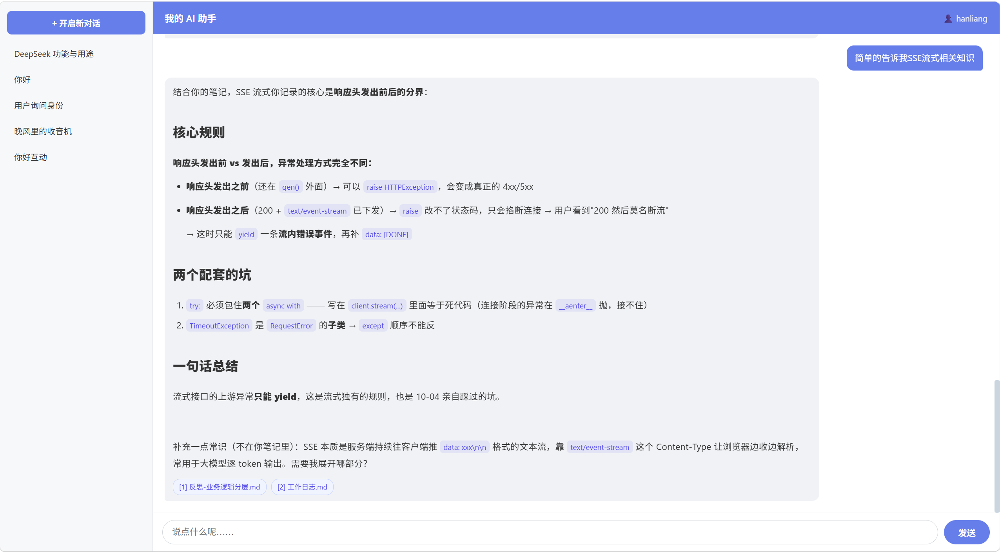
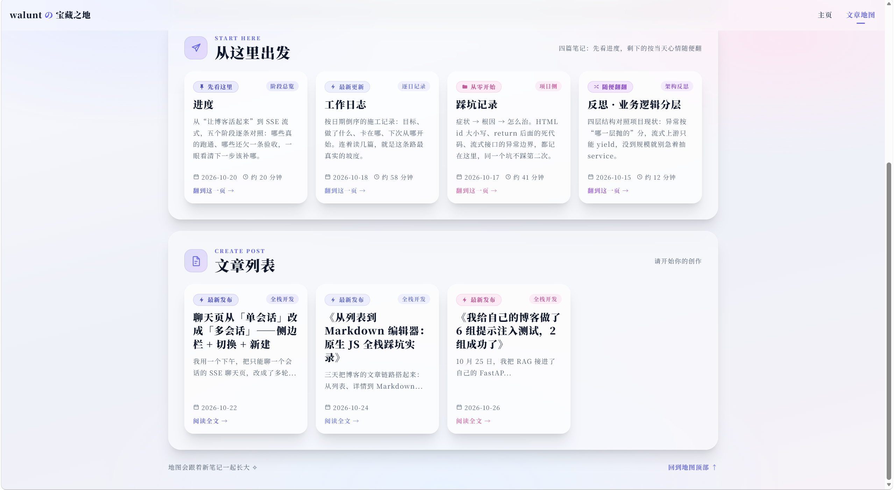
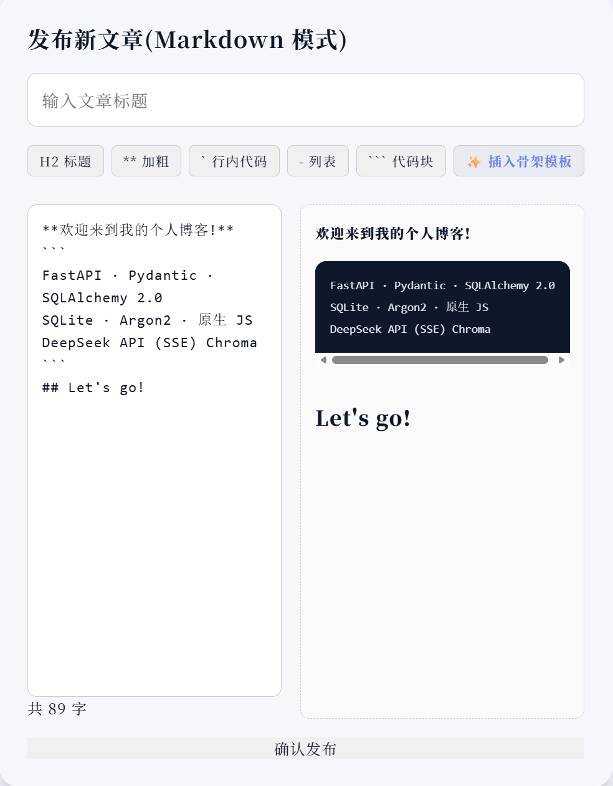
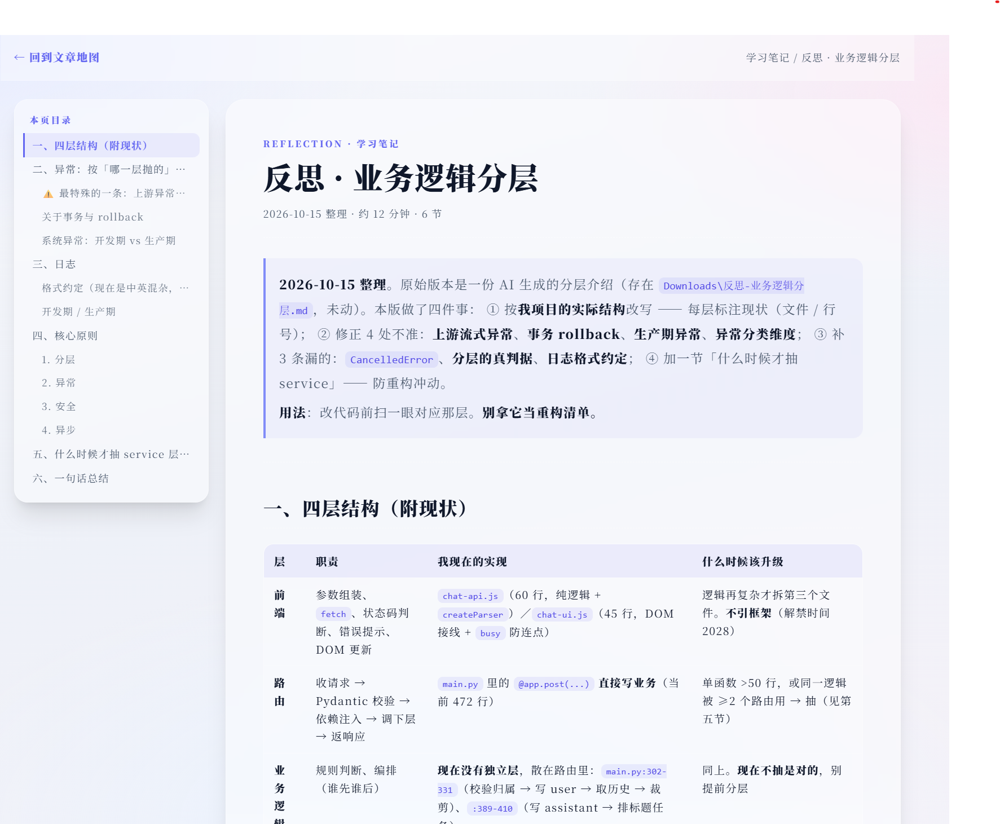
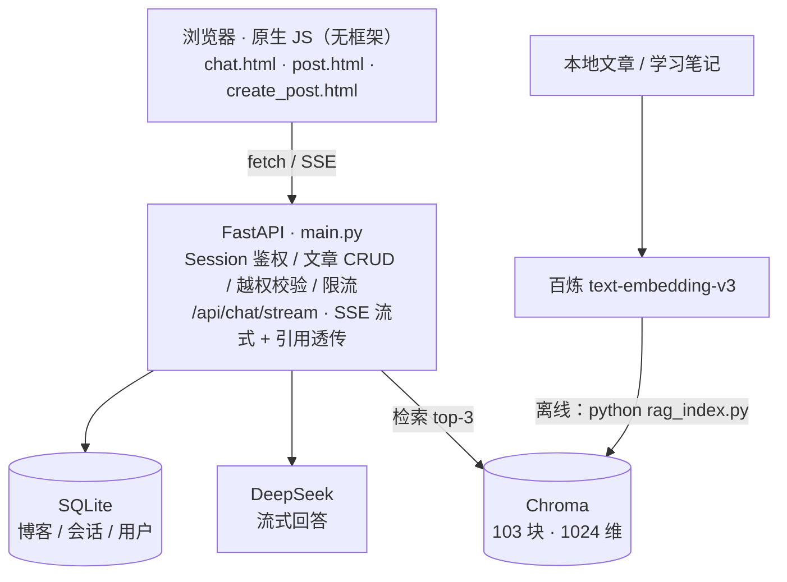

# Walunt's Blog  ·  个人博客 + RAG知识助手

一个从零手写的全栈项目：**原生JS前端 + FastAPI后端**，

聊天接deepseek（SSE流式），并把自己的文章/笔记向量化后做成检索增强（RAG），

回答时**带来源引用，点开就是原文**。

> 🌟 如果你觉得这个项目有意思，欢迎点个 Star ⭐️！

---

## 界面预览

| AI 对话（带 RAG 引用）                                                              | 博客文章列表                                                               |
|:-----------------------------------------------------------------------------------:|:--------------------------------------------------------------------------:|
|            |  |
| Markdown 编辑器（实时预览）                                                         | 文章阅读页（自动 TOC）                                                     |
|  |    |

---

## 核心功能

### AI对话模块(RAG)

- **SSE 流式对话**：接入 DeepSeek，打字机效果，支持多会话切换与侧边栏历史管理。
- **RAG 检索增强**：提问时自动检索向量库（Chroma），将相关的本地笔记注入上下文。
- **来源引用追溯**：AI 回答下方生成带编号的引用徽章，点击直接新开标签页跳转到对应原文。
- **自动生成标题**：利用大模型自动总结首轮对话，生成左侧会话列表标题。

### 博客系统模块

- **原生 Markdown 创作**：无框架手写编辑器，支持工具栏快捷插入、实时解析预览、字数统计。
- **文章渲染与防护**：前端 `marked` 解析 + `DOMPurify` 防 XSS，自动提取 `h2/h3` 生成侧边阅读目录。
- **全站安全**：Argon2 密码哈希、手写 Session Cookie 鉴权、滑动窗口限流器、严格的接口越权拦截（404 防枚举）。

---

## 系统架构



---

## 快速开始

### 1.环境准备

确保你安装了Python 3.10+。克隆项目并安装依赖：

```bash
git clone https://github.com/yourname/you-repo.git
cd your-repo
pip install -r requirements.txt
```

### 2.配置环境变量

复制 `.env.example` 文件并重命名为 `.env`，填入你自己的 API Key：

```bash
cp .env.example .env
```

需要配置的变量：

- `MydeepseekKey`: DeepSeek API Key（用于对话）

- `MyDashscopeKey`: 阿里云百炼 API Key（用于文本转向量）

### 3.初始化数据库与索引

```bash
python models.py
```

*(说明：运行后会自动生成 `blog.db`)*

```
python rag_index.py
```

*(说明：运行后会自动生成.chroma文件夹或者更新文件夹里的索引文件，你会看到类似于**写完：84块**的运行结果，初始或者笔记文章更新时都启动一次)*

### 4.启动服务

```bash
uvicorn main:app --reload
```

打开浏览器访问 http://127.0.0.1:8000/static/login.html 即可

> **首次使用请在登录页点击「去注册一个」创建账号。**

## 技术栈

- **后端**：FastAPI,SQLAlchemy 2.0，SQLite，Pydantic,httpx

- **前端**：原生 HTML / CSS / JS (无框架), marked.js, DOMPurify

- **AI & 向量**：DeepSeek API (SSE), 阿里云百炼 text-embedding-v3, ChromaDB

- **安全**：Argon2 (密码哈希), Session Cookie, 自定义限流器

---

## 项目结构

```text
main.py          # 路由与 API 入口
models.py        # ORM 模型 + 建表逻辑
security.py      # Argon2 密码哈希
dependencies.py  # 认证依赖 (Session)
rate_limit.py    # 滑动窗口限流器
rag.py           # 检索逻辑（请求时实时调用）
rag_index.py     # 离线建索引脚本（切块+向量化）
static/          # 原生前端 HTML/CSS/JS
学习笔记/         # 我的踩坑与开发记录
```

---

## 我写过的东西

- [我给自己的博客做了 6 组提示注入测试，2 组成功了]

- [聊天页从「单会话」改成「多会话」——侧边栏 + 切换 + 新建]

- [从列表到 Markdown 编辑器：原生 JS 全栈踩坑实录]

---

## 已知限制

- 目前为单用户场景设计，未做完整的 SaaS 级多租户数据隔离。

- RAG 索引更新为手动触发脚本（尚未实现发文章自动触发增量索引）。

- 尚未部署到云服务器，使用 SQLite 与本地 Chroma 文件。
